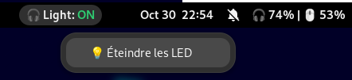

# Logitech Battery Widget

## Get Battery Level

A simple script to show the battery level of your wireless peripheral (mouse, headset, keyboard) on Linux (Debian). Designed to work with Logitech hardware, you should be able to adapt it with your own peripherals.

<div align="center">
<br>
  

  <br>
</div>

## How it works

1. The Python script fetches battery data and prints the output. To be resource-efficient, it connects directly to the Solaar D-Bus session to read the mouse battery (which is instantaneous and non-blocking), and it uses the `headsetcontrol -b` command to fetch the headset battery.

2. On GNOME environment, the plugin **Executor** allows you to run the script at regular intervals and you can choose where to display it.

<br>

## Installation

You will need these to run the script:

- Python 3.10 or higher
- The python pydbus library (installable via `sudo apt install python3-pydbus` on Debian/Ubuntu)
- solaar (https://github.com/pwr-Solaar/Solaar)
- HeadsetControl (https://github.com/Sapd/HeadsetControl)

Please refer to the Github pages of the projects to install them.
Once everything is installed:

### STEP 1 : Verify that tools work

- Check python version:

```bash
python3 --version
# Should print something like: Python 3.11.2
# You must be higher than 3.10
```

- Check solaar:

```bash
solaar show
# If you don't have any error and you can see the data of your peripheral(s), it's good.
# IMPORTANT: Solaar MUST be running in the background (tray icon) for the D-Bus optimization to work!
```

- Check headsetControl:

```bash
headsetcontrol -b
# If you don't have any error and you can see the data of your peripheral(s), it's good.
```

_NOTE : If you can't compile HeadsetControl, please read the "Troubleshooting" section below._

**Make sure these commands work because they are the foundation my script uses.**

---

### STEP 2 : Clone this repository and test the script

```bash
git clone https://github.com/HazeFury/logitech_battery_widget

cd logitech_battery_widget

# I recommend copying the script into a proper "scripts" folder near your home folder
cp get_battery_level.py ~/scripts

# Make the script executable
chmod +x ~/scripts/get_battery_level.py

# Verify it works well in your terminal
~/scripts/get_battery_level.py
# You should see something like: 🎧 72% | 🖱️ 50%
```

---

### STEP 3 : Install Extension Manager plugin and Executor

If you are using a GNOME environment, you can install the "**Extension Manager**" application on your desktop. Then:

1. Open your GNOME application menu and launch the Extensions Manager application (the icon is a small blue puzzle piece).
2. Go to the Browse tab at the top of the window.
3. In the search bar, type Executor.
4. Click the "Install" button next to the Executor extension (created by raujonas or similar).
5. Go back to the Installed tab. You should see Executor there. Click the small gear icon ⚙️ next to it to open its settings.

---

### STEP 4 : Setup Executor to run the script

In the Executor configuration window, you can define your widget:

**Command**: This is where you put the absolute path to your script.
e.g:
`/home/YOURNAME/scripts/get_battery_level.py`

**Interval**: You should definitely not leave the interval at the default (often 1 or 5 seconds) because it is useless. Your battery won't change in such a short time. Set this to 180 seconds (or more). I personally set interval to 300 second (5min) because I don't need to look at my battery level regularly.

**Location**: You can choose where to place it (usually Right or Center in the Top Bar).

**As soon as you confirm, you should see your little emojis and battery percentages appear directly in your GNOME bar at the top of your screen.**

<br>

---

## Troubleshooting

### "I can't compile the HeadsetControl project because of my older GCC version"

I had trouble installing 'HeadsetControl' because I was using Debian 12, and this caused problems compiling the project because it required a more recent version of GCC (like GCC 13).

If this happens to you, you need to use a Docker container of a system version that supports it (like Ubuntu 22.04), install GCC 13, and then force the compiler to statically link the C++ library in the executable.

Here's how it worked for me:

```bash
# On your machine
mkdir temp_folder && cd temp_folder
docker run -it -v $(pwd):/workspace ubuntu:22.04 bash

# inside the docker container
apt update
apt install -y software-properties-common wget build-essential git cmake libhidapi-dev
add-apt-repository ppa:ubuntu-toolchain-r/test -y
apt update
apt install -y gcc-13 g++-13
cd /tmp
git clone https://github.com/Sapd/HeadsetControl.git
cd HeadsetControl
mkdir build && cd build
export CC=gcc-13
export CXX=g++-13
export CXXFLAGS="-static-libstdc++ -static-libgcc"
export LDFLAGS="-static-libstdc++ -static-libgcc"
cmake ..
make
cp headsetcontrol /workspace/
cp 70-headsets.rules /workspace/
exit

# On your machine
sudo mv headsetcontrol /usr/local/bin/
sudo cp 70-headsets.rules /etc/udev/rules.d/
sudo udevadm control --reload-rules
sudo udevadm trigger
```

Unplug the dongle from your headset, plug it back in, and launch a simple:

```bash
headsetcontrol -b
```

You should see your headset data with the battery level :)


<br>

<br>

<br>

<br>

---

<br>

<br>

<br>

<br>

## Headset Light Control Widget (Interactive Toggle Button)

This optional companion widget adds an interactive button to your GNOME top bar to toggle your headset lighting on and off with immediate visual feedback (green `ON` / red `OFF`).

<div align="center">
<br>
  

  <br>
</div>

---

### How It Works

1. **State Persistence in Shared Memory**: Because status bar scripts run as transient processes, the current state is stored in `/dev/shm/headset_light.state` (mounted in RAM), ensuring instant reads/writes with zero disk I/O.
2. **Dual-Mode Script**: The Python script acts as both the display generator (formatting Pango markup for the status bar) and the CLI actuator (executing `headsetcontrol -l 0|1` when triggered with the `toggle` argument).
3. **Argos Extension**: Manages the button lifecycle, parsing stdout into a top bar indicator and triggering immediate re-renders upon clicking via `refresh=true`.

---

### Prerequisites & Compatibility

#### 1. HeadsetControl with LED Support (G522 Centurion Port)

Make sure your `headsetcontrol` binary includes the `lights` capability:

	headsetcontrol --capabilities

If `lights` is missing, you are running an older build. Rebuild HeadsetControl from the latest repository (which includes the G522 Centurion port) using Docker as described in the Troubleshooting section. Verify that hardware control works:

	headsetcontrol -l 0
	headsetcontrol -l 1

#### 2. Installing Argos on GNOME 43 (Debian 12)

Recent GNOME versions use ECMAScript Modules (ESM), which cause syntax errors (`import declarations may only appear at top level of a module`) on GNOME 43. To install the compatible pre-ESM version:

```bash
	# Clone the GNOME-44 compatible tag into a temporary folder
	git clone --branch GNOME-44 https://github.com/p-e-w/argos.git /tmp/argos-g44

	# Copy the extension directory to your local GNOME extensions folder
	cp -r /tmp/argos-g44/argos@pew.worldwidemann.com ~/.local/share/gnome-shell/extensions/
	rm -rf /tmp/argos-g44

	# Ensure version "43" is allowed in metadata.json
	nano ~/.local/share/gnome-shell/extensions/argos@pew.worldwidemann.com/metadata.json
```

Add `"43"` to the `"shell-version"` list if missing, then reload your GNOME session (`Alt + F2`, type `r`, and press `Enter` on X11, or log out and back in on Wayland). Finally, enable the extension:

	gnome-extensions enable argos@pew.worldwidemann.com

---

### Setting Up the Toggle Script

```bash
# 1. Create the Argos configuration directory:

	mkdir -p ~/.config/argos

# 2. Copy the script file and name it according to Argos naming conventions (`.c.` places it on the center of the panel, and `.10m.` sets the passive refresh interval):

    cp ./switch_headset_light.py ~/.config/argos/
	mv ~/.config/argos/switch_headset_light.py ~/.config/argos/headset_light.c.10m.py

3. Make the script executable:

	chmod +x ~/.config/argos/headset_light.c.10m.py
```

---

### Clean UI Patch (Removing the Default Script Link)

By default, Argos appends an extra separator and a shortcut opening the script source file in an editor at the bottom of the dropdown menu. To keep only the clean toggle action button:

```bash
# 1. Open `button.js`:

	nano ~/.local/share/gnome-shell/extensions/argos@pew.worldwidemann.com/button.js

# 2. Locate the end of the menu assembly method (around line 211) and comment out the following lines:

	// if (dropdownLines.length > 0)
	//   this.menu.addMenuItem(new PopupMenu.PopupSeparatorMenuItem());

	// let menuItem = new PopupMenu.PopupMenuItem(this._file.get_basename(), {
	//   style_class: "argos-menu-item-edit"
	// });
	// menuItem.connect("activate", Lang.bind(this, function() {
	//   Gio.AppInfo.launch_default_for_uri("file://" + this._file.get_path(), null);
	// }));
	// this.menu.addMenuItem(menuItem);

# 3. Reload GNOME Shell (`Alt + F2`, type `r`, press `Enter` on X11, or restart session on Wayland). The dropdown menu now displays exclusively your action button.
```